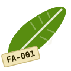

# Banana Thesis Tracker

Installable task tracker app for the thesis
**"An Enhanced EfficientNetB0 Architecture for Mobile Banana Leaf Disease Classification"**
(BSCS Capstone, University of Mindanao).

- **Team:** Fe Anne Malasarte (Team Leader), Rho Alphone Jornadal (ML Lead), Charisse Priego (Documentation Lead)
- **Frontend:** this repo, hosted free on GitHub Pages. It's an installable app (PWA) that works offline with the last synced data.
- **Database:** the team's Google Sheet, reached through a small Apps Script API. Every change is logged with who made it on the sheet's **Activity** tab.

## Update the Apps Script (copy and paste)
The script files and manifest are in the [`apps-script`](apps-script/) folder of this repo:
- [ThesisTracker.gs](apps-script/ThesisTracker.gs) · [raw](https://raw.githubusercontent.com/Feliciety02/ThesisTracker/main/apps-script/ThesisTracker.gs)
- [WebApp.gs](apps-script/WebApp.gs) · [raw](https://raw.githubusercontent.com/Feliciety02/ThesisTracker/main/apps-script/WebApp.gs)
- [appsscript.json](apps-script/appsscript.json) · grants full Drive access needed to create photo files

Use the local files above when working from this checkout; the GitHub `main` raw links may be older than local changes.

1. Open a file above and click **Copy raw file** (the icon top-right of the code), or open **raw**, select all, copy.
2. In the sheet: **Extensions → Apps Script**. Open each `.gs` file with the same name, select everything, delete, paste. In **Project Settings**, enable **Show "appsscript.json" manifest file in editor**, then replace its contents with the local `appsscript.json` above. The old `index.html` is not needed in Apps Script.
3. **Save** → run **setupTracker** (keeps all data) from the script editor. Its result appears in **Execution log**.
4. Run **setupPhotoFolder** from the editor and approve the requested Google Drive access. Check **Execution log** for “Photo folder connected.” The account that deploys the web app needs edit access to the team's Drive folder.
5. **Deploy → Manage deployments → pencil icon → Version: New version → Deploy**. Confirm the web app runs as **Me** (the Drive-authorized owner).

If `setupPhotoFolder` reports a missing Drive scope, open **Project Settings**, show `appsscript.json`, and check its `oauthScopes` list. If that list exists, replace `https://www.googleapis.com/auth/drive.readonly` with `https://www.googleapis.com/auth/drive` (or add the full Drive scope), keeping its other scopes. Save, run `setupPhotoFolder` again, and use the new authorization prompt. The photo upload creates files, so read-only Drive access is insufficient. If the manifest has no explicit `oauthScopes`, check **Overview → Project OAuth Scopes** for Drive and rerun the function to authorize it.

If the older deployed script says `Cannot call SpreadsheetApp.getUi() from this context` when `setupPhotoFolder` runs in the editor, open the tracker Google Sheet and choose **Thesis Tracker → Connect photo folder**. That menu runs in a Sheet UI context and can request Drive authorization. The updated `WebApp.gs` above also fixes editor runs.

### 1. Google Sheet + Apps Script (once)
1. In the tracker Google Sheet, open **Extensions → Apps Script**. You need two script files there:
   - `ThesisTracker.gs`
   - `WebApp.gs` (the API)

   If an HTML file named `Index` is there from before, delete it.
2. In Apps Script, go to **Deploy → New deployment → Web app**:
   - Execute as: **Me**
   - Who has access: **Anyone**
3. Copy the **Web app URL**. It ends in `/exec`.
4. In Apps Script, run **setupTracker** (or, in the sheet, **Thesis Tracker → Repair / update tracker**). It is safe to run any time: tabs that already have data — tasks, panel items, DA RCPC samples, expenses — are kept untouched; only missing or empty tabs are built.
5. Back in the sheet, run **Thesis Tracker → Connect photo folder** once. This connects the sample photo folder (one folder per member and per leaf) and grants Drive permission. The script owner needs edit access to that folder. If you deployed before this step, make a **New version** of the deployment.

### 2. GitHub Pages
1. Upload all files in this folder to the repo root, including `.nojekyll` and the `icons/` folder.
2. Edit `config.js` and paste the Web app URL between the quotes.
3. Go to **Settings → Pages → Build and deployment**:
   - Source: **Deploy from a branch**
   - Branch: **main**, folder **/ (root)**
   - Save.
4. After about a minute, the app is live at `https://<your-username>.github.io/<repo-name>/`.

### 3. Install on phones
- **Android native app (named Gallery photos and background Drive upload):** download the [signed team APK](https://github.com/Feliciety02/ThesisTracker/releases/download/android-team-1.0.11-2026-11-09/Banana-Thesis-Tracker-Android-1.0.11.apk). Installing the website from Chrome does not give it native Gallery access or Android background uploads.
- **Android web app (Chrome):** open the link, then tap **Install** on the first screen, or on the Home card that shows until the app is installed (or ⋮ → Install app).
- **iPhone (Safari):** open the link, then Share → **Add to Home Screen**.
- **Laptop (Chrome / Edge):** use the install icon in the address bar.

When the app opens for the first time it asks to be installed (or **Not now**), then asks you to sign in.

### Build the Android app

The Android app uses an in-app viewfinder for consecutive sample shots. It writes each sample photo to the public Pictures gallery under its sample filename before queuing the Drive upload. If the in-app viewfinder is unavailable, it uses the phone's camera app and still creates a named Gallery copy. The Google Drive destination and login are the same as the website.

1. Install Node.js, Java 21 and the Android SDK (Android Studio includes the SDK).
2. In this repository run `npm ci`, then `npm run sync:native`.
3. In `android/`, run `./gradlew assembleDebug` (Windows: `.\gradlew.bat assembleDebug`).
4. Install `android/app/build/outputs/apk/debug/app-debug.apk` on the phone for local development only. Share the signed team APK linked above instead.
5. Sign in again inside the Android app. The Chrome-installed web app has separate local storage, so finish syncing its pending photos before switching.

After a capture, look in Gallery → **Banana Thesis Tracker** for files such as `FA-001_01.jpg`. The app shows **Google Drive upload successful** only after the server confirms the save. If Wi-Fi or mobile data is unavailable, Android keeps a private upload copy and schedules a retry when a network returns, even when the app is closed. Android may delay background jobs during battery saving or after a force-stop; opening the app resumes the check. Do not clear app data while uploads are pending.

The signed team APK uses a different certificate from the older debug test APK. Android cannot update the debug installation in place. Let all pending photos finish uploading before uninstalling the debug app and installing the team APK. The release signing key is stored outside this repository in the owner's local AppData; keep a secure backup of it for future updates. The team APK is public to download, but only the configured accounts can sign in.

## Accounts
Only the team's six emails (two per member, listed in `accounts` in `ThesisTracker.gs`) can sign in.

- **First time:** type your email → a 6-digit code is emailed to you → type the code and choose a password (8+ characters). Each email has its own password.
- **After that:** you stay signed in on that phone until you tap your avatar → **Log out**.
- **Forgot password?** Tap it on the sign-in screen to get a new code.
- **Locked out / lost access:** in the sheet, **Thesis Tracker → Reset someone's app password** signs that email out everywhere so they can set a new password.
- To add or change emails, edit `accounts` in `CFG` at the top of `ThesisTracker.gs`, then deploy a new version.
- Passwords are stored only as salted hashes in the script's properties, never in the sheet. 5 wrong tries locks that email for 10 minutes.

## Samples, labels and photos
- Tap **New sample** on the Samples page (phone only). The app gives the next label automatically: **FA-###** (Fe Anne), **RJ-###** (Rho), **CP-###** (Cha). It works offline too.
- In the Android app, take five distinct photos per sample: **whole leaf**, **left side only**, **top lesions**, **right side only**, and **back in different light**. If the leaf is healthy, photograph the top area clearly for photo 3. The viewfinder advances after each shot. Every accepted shot is saved in Gallery as `<sample>_01.jpg` through `_05.jpg`; retaking an angle replaces that named Gallery copy. Existing photos stay in place, but photos taken under the older angle guide should be retaken if they do not match these five views. The website's in-app camera remains available but cannot save to Gallery automatically.
- The last screen reminds you to cut and label the leaf, then use RCPC-approved packaging. Add wet cotton only if RCPC specifically requires it. The site is copied from your previous leaf and the GPS location is saved automatically.
- **You don't decide the disease. DA RCPC does.** Leaves show *Not sent yet*, then *Waiting for RCPC*, then the RCPC result. You can still add a guess when editing a leaf, but it's optional and never counted.
- To retake a photo, tap on the leaf's card, then tap the photo.
- To delete a leaf: on its card tap **Edit → Delete sample** (phone). Its photos (and any copies exported for training) go to the Drive trash, and the label is freed: your next new sample reuses the lowest free number.
- Photos are saved to the team's [Drive folder](https://drive.google.com/drive/folders/1Aggb0xA3w6yf6cVSRiO4CbKUK6bWH8IF), inside a dedicated **DA RCPC Samples** folder, one folder per member and one per leaf: `DA RCPC Samples / Fe Anne (FA) / FA-001 / FA-001_01.jpg … _05.jpg`. Photos added to a leaf folder by hand are renamed to that pattern every 15 minutes (or via **Thesis Tracker → Rename sample photos now**). Running **setupTracker** (or **Connect photo folder**) moves photos saved by older versions into these folders.
- **Phone copy:** the Android app saves each capture directly to Gallery with the sample filename. On the website, Android users must tap **Download photos** and check Downloads or Files; a browser download may not appear in Gallery. On iPhone's website, tap **Save photos to Photos**, then **Save Images** in the Share sheet. The website keeps a recoverable copy until you confirm it is on the phone. Drive keeps the newest photo for each angle.
- If the in-app camera isn't allowed, the app falls back to the phone's camera app.

## Field day
- **Nov 9 DahonMD meeting:** the updated script adds a high-priority task due Nov 9 for each member. Until those rows reach the live sheet, the updated app shows the agenda in an expandable card. The four sections cover meeting decisions, RCPC requirements, collection preparation, and laboratory/testing. The 100-leaf target, 20 backup candidates, disease classes, and 80/20 collection split remain proposals until the meeting approves them.
- **Next-day rule:** every leaf must reach DA RCPC **the day after it's collected**. Each leaf shows *Send to RCPC by tomorrow* / *today*; Home and Samples show a red alert while leaves are due. A leaf that's sent later (or never) is marked **invalid**: it can't go on the submission list, isn't counted in the paper numbers, isn't exported for training, and its row turns red in the sheet.
- **Before the farm** checklist (Samples page): supplies bought, phone charged, app ready offline, tape, RCPC-approved packaging, and clean shears. It resets every day.
- **Leaves goal**: set it on the Samples page. The progress bar shows the team total.
- **Submission list**: tick the leaves you're handing over and print or save it as a PDF for DA RCPC. It lists label, date, site and notes, with signature lines and no disease column. On a phone, **Mark as submitted** stamps them all at once.
- **When DA RCPC sends results** (likely as their own spreadsheet): copy each leaf's result into the **RCPC Validated Class** column of the **DA RCPC Samples** tab, matching by label. The app picks them up by itself: leaves show the RCPC result, and **Paper numbers** appears, counting **only RCPC-confirmed leaves**.

## Training, consultations, final defense (More tab)
- **Training runs**: log each baseline / enhanced run (accuracy, precision, recall, F1, size, phone speed). **Copy table for Chapter 4** copies the best run per model; paste it into Google Docs and it becomes a table.
- **Consultations**: date, who, topic, feedback, what you changed, open/done, signed.
- **Final defense**: set the date for a countdown and tick off the checklist (who finished each item is recorded).
- These are also tabs in the Google Sheet: **Training Runs**, **Consultations**, **Final Defense**.

## Laptops and desktops
Sample collection is view-only on a computer: no camera, no New sample. You can switch the Samples page to **Photos** to see every leaf's photos (you need to be signed in to Google with access to the folder) and print the submission list.

## Live updates
Every change in the app is written to the Google Sheet right away (or, offline, as soon as there's signal). Open apps check for changes every 10 seconds, so what a teammate changes in the app, or what anyone types directly in the Google Sheet, shows up on everyone's screen within seconds. The footer shows **● Live · synced (time)**.

## Working on the farm (no signal)
- **Before leaving:** open the app once with signal and make sure you're logged in. That saves the app and the latest data on the phone.
- **On the farm:** use it normally. Sample details, checkboxes, tasks, and photos are all saved on the phone. An **Offline** bar and an **N to sync** counter show what's waiting.
- **Back in signal:** open the app. It syncs everything by itself, in order: changes first, then photos. The counter disappears when it's done.
- Don't uninstall the app or clear the browser's data while **N to sync** is showing, or the waiting photos are lost.

## Expenses and receipts
- The **Expenses** page is for anything the thesis costs: sample supplies, printing, transport, food, fees. Anyone can add what they bought, mark who paid, and edit or delete any entry.
- Tap **Receipt** on an expense to photograph it. The Android app saves it to Gallery; the website needs an explicit **Download receipt** or iPhone **Save receipt to Photos** action. The app also uploads it to the Drive folder **Banana Thesis – Receipts** (shared with the team, kept out of the dataset folder) and links it in the sheet. The upload waits on the phone while offline.
- The page shows the total spent, what's still to buy, and how much each person has paid.

## Who does what
- Every task and panel item shows **Assigned to** (who is supposed to do it) and, once finished, **Done by** (who actually did it). Anyone can complete anyone's item; the app fills in *Done by* automatically, and lets you correct it.
- **Panel → Revisions:** each item has a **Complied / Not yet / N/A** switch; after Complied, add the page no. and tick *Signed by adviser*. **Select** lets you update several at once. The **Defense readiness** card counts items complied, with a page number, and signed by the adviser.
- **Tasks:** if anything is overdue, a red bar lets you move all of them to a new date in one tap.

## For the paper and for training
- **Paper numbers** (Samples page): per-class counts from RCPC results only, with a ready-to-paste paragraph for *2.1.2 Local Test Set*.
- **Export validated photos**: copies every RCPC-validated sample's photos into class folders in **RCPC Validated Local Set** (outside the curated dataset folder, so it never adds a fake class). Safe to run again. Also in the sheet menu.
- **Photo quality check:** if a photo looks blurry, too dark or washed out, a warning sign appears on it (it never stops you); tap it to retake while the leaf is still there.
- **Location:** each new sample saves its GPS position (works without signal) with a map link.

## Panel: NG & Grade Processing checklist
**Panel → NG checklist** follows the official *Thesis and Capstone Project 1 · NG & Grade Processing internal checklist*: photocopies (step 1), the original forms in a Red/Blue Starfile folder with the minutes on top and parental consents at the bottom (step 2), RC pre-checking, and the NG grade in CRMS. Papers each member needs individually (exam permit, Research Undergraduate Agreement, Parental Consent) get one row per member. It's also the **NG Checklist** tab in the sheet.

## Dataset sources
**More → Dataset sources**: every online dataset used (Kaggle, Mendeley Data, papers, Drive folders …) with its link, license / how to cite, and how many images per class came from it. The table totals each class; **Copy table for the paper** pastes into Google Docs as a table. Also the **Dataset Sources** tab in the sheet.

## Linked tasks (automatic)
After every change, related items update themselves (they only move forward, never undo what someone set):
- All panel items complied with page no. → *Final defense: All panel revisions complied* is ticked; all signed → *Adviser signs the revision matrix* is ticked.
- All of a member's panel items complied → their *Panel Revision* task is Done.
- All sample-collection supplies paid → *Buy supplies* is Done.
- A member's first sample → their *Collect + photograph your samples* task is In Progress; samples submitted → *Submit fresh, labeled samples* is Done.
- A baseline training run logged → *Retrain the baseline* is Done.
- A dataset source logged → Rho's sources task is In Progress.
- A consultation about the minutes marked **Signed** → NG item *Minutes of the outline defense* is ticked and the minutes-signing task is Done.
- NG checklist progress → the NG tasks move to In Progress / Done.
Each automatic change is written to the **Activity** tab as *Auto*.

## Weekly progress email
Every Sunday at 7 PM the team gets one email: tasks done that week, open and overdue tasks, samples collected, RCPC results, panel items complied, and the upcoming dates. **Thesis Tracker → Send the weekly progress email now** sends it any time; another menu item turns it off.

## Backups
A dated copy of the tracker sheet is saved to **Banana Thesis – Backups** every Sunday night (newest 8 kept). **Thesis Tracker → Back up this sheet now** makes one any time.

## Everyone is an admin
All three members can add, edit and delete tasks (the pencil icon on a task) and expenses (Add, edit any field, delete), and edit any sample. Every change is logged with who made it on the sheet's **Activity** tab.

## Updating
- **Changed `index.html`?** Bump `VERSION` in `sw.js` (for example `bt-v2`) so installed apps pick up the change.
- **Changed `WebApp.gs` or `ThesisTracker.gs`?** In Apps Script: Deploy → Manage deployments → pencil icon → Version: **New version** → Deploy. The URL stays the same.

## Notes
- Only the six team emails can sign in. Every edit is logged on the **Activity** tab, so you can always see who changed what.
- If `config.js` still has the placeholder, the app runs in **demo mode** with sample data.
- If your school account doesn't offer "Anyone" as a deployment option, deploy the Apps Script from a personal Gmail copy of the sheet instead.
