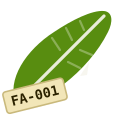

# Banana Thesis Tracker

Installable task tracker app for the thesis
**"An Enhanced EfficientNetB0 Architecture for Mobile Banana Leaf Disease Classification"**
(BSCS Capstone, University of Mindanao).

- **Team:** Fe Anne Malasarte (Team Leader), Rho Alphone Jornadal (ML Lead), Charisse Priego (Documentation Lead)
- **Frontend:** this repo, hosted free on GitHub Pages. It's an installable app (PWA) that works offline with the last synced data.
- **Database:** the team's Google Sheet, reached through a small Apps Script API. Every change is logged with who made it on the sheet's **Activity** tab.

## Setup

### 1. Google Sheet + Apps Script (once)
1. In the tracker Google Sheet, open **Extensions → Apps Script**. You need two script files there:
   - `ThesisTracker.gs`
   - `WebApp.gs` (the API)

   If an HTML file named `Index` is there from before, delete it.
2. In Apps Script, go to **Deploy → New deployment → Web app**:
   - Execute as: **Me**
   - Who has access: **Anyone**
3. Copy the **Web app URL**. It ends in `/exec`.
4. In Apps Script, run **setupTracker** (or, in the sheet, **🍌 Thesis Tracker → 🛠 Repair / update tracker**). It is safe to run any time: tabs that already have data — tasks, panel items, DA RCPC samples, expenses — are kept untouched; only missing or empty tabs are built.
5. Back in the sheet, run **🍌 Thesis Tracker → 📷 Connect photo folder** once. This connects the Curated Banana Leaf Disease Dataset folder (photos go into its **DA RCPC Sample Photos** subfolder) and grants Drive permission. If you deployed before this step, make a **New version** of the deployment.

### 2. GitHub Pages
1. Upload all files in this folder to the repo root, including `.nojekyll` and the `icons/` folder.
2. Edit `config.js` and paste the Web app URL between the quotes.
3. Go to **Settings → Pages → Build and deployment**:
   - Source: **Deploy from a branch**
   - Branch: **main**, folder **/ (root)**
   - Save.
4. After about a minute, the app is live at `https://<your-username>.github.io/<repo-name>/`.

### 3. Install on phones
- **Android (Chrome):** open the link, then tap **⬇ Install** on the first screen (or ⋮ → Install app).
- **iPhone (Safari):** open the link, then Share → **Add to Home Screen**.
- **Laptop (Chrome / Edge):** use the install icon in the address bar.

When the app opens for the first time it asks to be installed (or **Not now**), then asks you to sign in.

## Accounts
Only the team's six emails (two per member, listed in `accounts` in `ThesisTracker.gs`) can sign in.

- **First time:** type your email → a 6-digit code is emailed to you → type the code and choose a password (8+ characters). Each email has its own password.
- **After that:** you stay signed in on that phone until you tap your avatar → **Log out**.
- **Forgot password?** Tap it on the sign-in screen to get a new code.
- **Locked out / lost access:** in the sheet, **🍌 Thesis Tracker → 🔑 Reset someone's app password** signs that email out everywhere so they can set a new password.
- To add or change emails, edit `accounts` in `CFG` at the top of `ThesisTracker.gs`, then deploy a new version.
- Passwords are stored only as salted hashes in the script's properties, never in the sheet. 5 wrong tries locks that email for 10 minutes.

## Samples, labels and photos
- Tap **＋ New sample** on the Samples page (phone only). The app gives the next label automatically: **FA-###** (Fe Anne), **RJ-###** (Rho), **CP-###** (Cha). It works offline too.
- The camera opens inside the app, like the phone's own camera: **tap the shutter 3 times**, once each for the top surface, the underside and a close-up of the spots. There's no waiting between taps. After the 3rd photo it moves on by itself.
- The last screen is just instructions: cut the leaf, wrap the end in damp cotton, bag it, and stick the label (e.g. RJ-004) on masking tape. Nothing to tick or type. The site is copied from your previous leaf and the GPS location is saved automatically.
- **You don't decide the disease. DA RCPC does.** Leaves show *Not sent yet*, then *Waiting for RCPC*, then the RCPC result. You can still add a guess when editing a leaf, but it's optional and never counted.
- To retake a photo, tap 📷 on the leaf's card, then tap the photo.
- Photos are saved to the **DA RCPC Sample Photos** folder inside the Curated Banana Leaf Disease Dataset folder, named `<label>_01.jpg … _03.jpg`.
- If the in-app camera isn't allowed, the app falls back to the phone's camera app.

## Field day
- **Before the farm** checklist (Samples page): supplies bought, phone charged, app ready offline, tape, cotton, bags, shears. It resets every day.
- **Leaves goal** and **per disease goal**: set them on the Samples page. The progress bar shows the team total.
- **📝 Submission list**: tick the leaves you're handing over and print or save it as a PDF for DA RCPC. It lists label, date, site and notes, with signature lines and no disease column. On a phone, **Mark as submitted** stamps them all at once.
- **🧪 Enter RCPC results**: when results come back, step through each leaf and tap the class.
- **📄 Paper numbers** count **only RCPC-confirmed leaves**.

## Training, consultations, final defense (More tab)
- **Training runs**: log each baseline / enhanced run (accuracy, precision, recall, F1, size, phone speed). **📋 Copy table for Chapter 4** copies the best run per model; paste it into Google Docs and it becomes a table.
- **Consultations**: date, who, topic, feedback, what you changed, open/done, signed.
- **Final defense**: set the date for a countdown and tick off the checklist (who finished each item is recorded).
- These are also tabs in the Google Sheet: **Training Runs**, **Consultations**, **Final Defense**.

## Laptops and desktops
Sample collection is view-only on a computer: no camera, no New sample. You can switch the Samples page to **🖼 Photos** to see every leaf's photos (you need to be signed in to Google with access to the folder) and print the submission list.

## Working on the farm (no signal)
- **Before leaving:** open the app once with signal and make sure you're logged in. That saves the app and the latest data on the phone.
- **On the farm:** use it normally. Sample details, checkboxes, tasks, and photos are all saved on the phone. A **📴 Offline** bar and a **⏳ N to sync** counter show what's waiting.
- **Back in signal:** open the app. It syncs everything by itself, in order: changes first, then photos. The ⏳ counter disappears when it's done.
- Don't uninstall the app or clear the browser's data while ⏳ is showing, or the waiting photos are lost.

## Expenses and receipts
- The **Expenses** page is for anything the thesis costs: sample supplies, printing, transport, food, fees. Anyone can add what they bought, mark who paid, and edit or delete any entry.
- Tap **📷 Receipt** on an expense to photograph the receipt. It's saved to the Drive folder **Banana Thesis – Receipts** (shared with the team, kept out of the dataset folder) and linked in the sheet. Works offline too.
- The page shows the total spent, what's still to buy, and how much each person has paid.

## Who does what
- Every task and panel item shows **Assigned to** (who is supposed to do it) and, once finished, **✓ Done by** (who actually did it). Anyone can complete anyone's item; the app fills in *Done by* automatically, and ✏️ lets you correct it.
- **Panel Revisions:** tick items (or ☑ *Select all shown*) and tap **✓ Mark complied · done by me**. The **Defense readiness** card counts items complied, with a page number, and signed by the adviser.
- **Tasks:** if anything is overdue, a red bar lets you move all of them to a new date in one tap.

## For the paper and for training
- **📄 Paper numbers** (Samples page): per-class counts from RCPC results only, with a ready-to-paste paragraph for *2.1.2 Local Test Set*.
- **📦 Export validated photos**: copies every RCPC-validated sample's photos into class folders in **RCPC Validated Local Set** (outside the curated dataset folder, so it never adds a fake class). Safe to run again. Also in the sheet menu.
- **Photo quality check:** if a photo looks blurry, too dark or washed out, a ⚠️ appears on it (it never stops you); tap it to retake while the leaf is still there.
- **Location:** each new sample saves its GPS position (works without signal) with a 📍 map link.

## Weekly progress email
Every Sunday at 7 PM the team gets one email: tasks done that week, open and overdue tasks, samples collected, RCPC results, panel items complied, and the upcoming dates. **🍌 Thesis Tracker → 📬 Send the weekly progress email now** sends it any time; another menu item turns it off.

## Backups
A dated copy of the tracker sheet is saved to **Banana Thesis – Backups** every Sunday night (newest 8 kept). **🍌 Thesis Tracker → 💾 Back up this sheet now** makes one any time.

## Everyone is an admin
All three members can add, edit and delete tasks (✏️ on a task) and expenses (＋ Add, edit any field, 🗑 delete), and edit any sample. Every change is logged with who made it on the sheet's **Activity** tab.

## Updating
- **Changed `index.html`?** Bump `VERSION` in `sw.js` (for example `bt-v2`) so installed apps pick up the change.
- **Changed `WebApp.gs`?** In Apps Script: Deploy → Manage deployments → ✏️ → Version: **New version** → Deploy. The URL stays the same.

## Notes
- Only the six team emails can sign in. Every edit is logged on the **Activity** tab, so you can always see who changed what.
- If `config.js` still has the placeholder, the app runs in **demo mode** with sample data.
- If your school account doesn't offer "Anyone" as a deployment option, deploy the Apps Script from a personal Gmail copy of the sheet instead.
